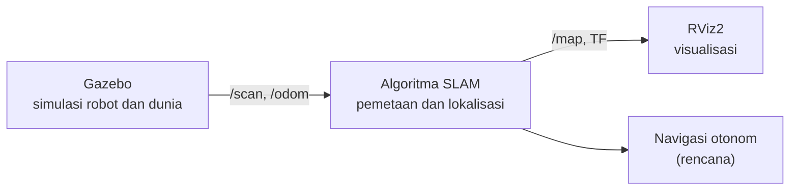

  

 

<!-- Layout dua kolom: kiri tentang saya, kanan tech stack dan kontak -->
<table>
<tr>
<td valign="top" width="50%">

### Tentang Saya

Saya Muhammad Yasir Assafa. Saat ini saya membangun robot berbasis ROS2 dengan algoritma SLAM, memakai Gazebo untuk simulasi dan RViz2 untuk visualisasi.

- Sedang dikerjakan: robot SLAM dengan ROS2
- Sedang dipelajari: navigasi otonom dan pemetaan lingkungan
- Terbuka untuk diskusi dan kolaborasi robotika

</td>
<td valign="top" width="50%">

### Tech Stack

### Kontak

</td>
</tr>
</table>

## Proyek Saat Ini: Robot SLAM dengan ROS2

Robot yang memetakan lingkungan sambil menentukan posisinya sendiri. Pengembangan dan pengujian dilakukan di simulasi sebelum dicoba pada robot nyata.

| Komponen | Fungsi |
|:---------|:-------|
| ROS2 | Framework utama robot |
| Gazebo | Simulasi robot dan lingkungan |
| RViz2 | Visualisasi peta, sensor, dan posisi robot |
| SLAM | Pemetaan dan lokalisasi secara bersamaan |

Rencana pengembangan

 

- [x] Model robot dan dunia simulasi di Gazebo
- [x] Visualisasi data sensor di RViz2
- [ ] Pemetaan dengan algoritma SLAM
- [ ] Navigasi otonom pada peta yang dibuat
- [ ] Uji coba pada robot nyata

## Statistik GitHub

## Aktivitas Terbaru

<!-- Bagian ini diisi otomatis oleh workflow activity.yml -->
<!--START_SECTION:activity-->
<!--END_SECTION:activity-->

## Repositori Pilihan

<!-- Ganti REPO-1 sampai REPO-4 dengan nama repo kamu -->

## Kontribusi

<!-- Butuh workflow snake.yml, kalau tidak dipakai hapus bagian ini -->
<picture>
  <source media="(prefers-color-scheme: dark)" srcset="https://raw.githubusercontent.com/USERNAME/USERNAME/output/github-snake-dark.svg" />
  <source media="(prefers-color-scheme: light)" srcset="https://raw.githubusercontent.com/USERNAME/USERNAME/output/github-snake.svg" />
  
</picture>

  

