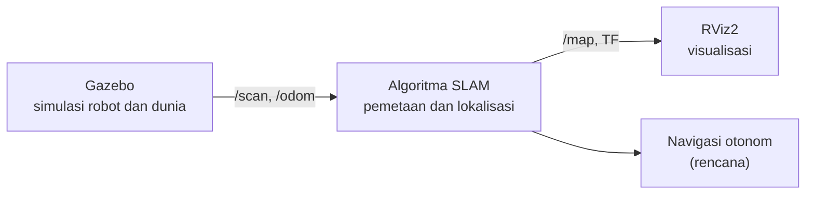
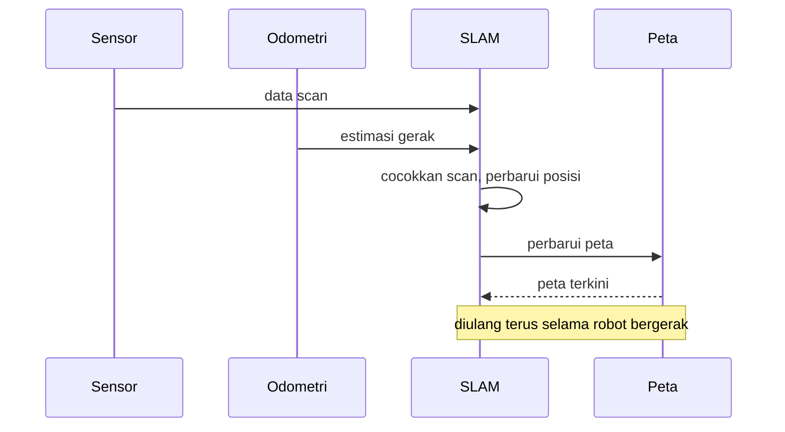
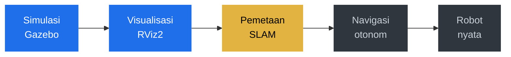

<!-- Profil GitHub kyami-sirr. Edit bagian yang perlu saja -->

<div align="center">


<a href="https://github.com/kyami-sirr">
  
</a>

<br/><br/>


<br/><br/>

<!-- Menu navigasi, klik untuk lompat ke bagian -->
<a href="#tentang-saya"></a>
<a href="#proyek-robot-slam"></a>
<a href="#tanya-jawab-singkat"></a>
<a href="#tech-stack"></a>
<a href="#statistik-github"></a>
<a href="#kontak"></a>

</div>

<br/>

## Tentang Saya

Saya Muhammad Yasir Assafa. Saat ini saya membangun robot berbasis ROS2 dengan algoritma SLAM, memakai Gazebo untuk simulasi dan RViz2 untuk visualisasi.

| | |
|:--|:--|
| Sedang dikerjakan | Robot SLAM dengan ROS2, Gazebo, dan RViz2 |
| Sedang dipelajari | Navigasi otonom dan pemetaan lingkungan |
| Terbuka untuk | Diskusi dan kolaborasi di bidang robotika |

## Proyek Robot SLAM

Robot yang memetakan lingkungan sambil menentukan posisinya sendiri. Semua dikembangkan dan diuji di simulasi dulu sebelum dicoba pada robot nyata.

### Alur data robot



### Cara kerja satu siklus SLAM



### Peta jalan



Biru: selesai. Kuning: sedang dikerjakan. Abu-abu: rencana.

<details>
<summary><b>Cara menjalankan (klik untuk buka)</b></summary>
<br/>

```bash
# Bangun workspace
cd ~/ros2_ws
colcon build --symlink-install
source install/setup.bash

# Jalankan simulasi (ganti nama paket dan launch file)
ros2 launch <nama_paket> <simulasi>.launch.py

# Buka RViz2
rviz2
```

</details>

<details>
<summary><b>Rencana pengembangan (klik untuk buka)</b></summary>
<br/>

- [x] Model robot dan dunia simulasi di Gazebo
- [x] Visualisasi data sensor di RViz2
- [ ] Pemetaan dengan algoritma SLAM
- [ ] Navigasi otonom pada peta yang dibuat
- [ ] Uji coba pada robot nyata

</details>

## Tanya Jawab Singkat

<details>
<summary><b>Apa itu SLAM?</b></summary>
<br/>

SLAM (Simultaneous Localization and Mapping) adalah cara robot membuat peta lingkungan sambil menentukan posisinya sendiri di peta itu, pada saat yang sama.

</details>

<details>
<summary><b>Apa itu ROS2?</b></summary>
<br/>

ROS2 (Robot Operating System 2) adalah kumpulan alat dan pustaka untuk membangun perangkat lunak robot. Bagian-bagian robot saling bertukar data lewat node dan topic.

</details>

<details>
<summary><b>Kenapa mulai dari Gazebo?</b></summary>
<br/>

Simulasi membuat saya bisa mencoba algoritma berulang kali tanpa risiko merusak robot, dan tanpa harus menyiapkan lingkungan fisik setiap kali.

</details>

<details>
<summary><b>Apa fungsi RViz2?</b></summary>
<br/>

RViz2 menampilkan apa yang "dilihat" robot: data sensor, peta yang sedang dibuat, posisi robot, dan hasil navigasi. Ini sangat membantu untuk debugging.

</details>

## Tech Stack

<div align="center">


</div>

## Statistik GitHub

<div align="center">


</div>

## Kontak

<div align="center">

<a href="https://linkedin.com/in/kyami-sirr"></a>
<a href="mailto:emailkamu@gmail.com"></a>
<a href="https://instagram.com/kyami-sirr"></a>

<br/><br/>

Kalau proyek saya bermanfaat, kasih bintang ya.

</div>


